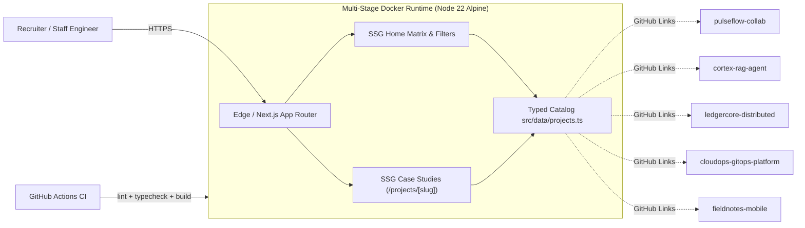

# portfolio-web — Engineering Portfolio Hub

Sitio web principal del portafolio profesional. Funciona como **vitrina técnica central** que conecta 5 repositorios públicos independientes, documentando cada uno como un *Case Study* de arquitectura de software, problema de negocio resuelto y métricas de ingeniería.

---

## Arquitectura del Hub



---

## Proyectos Insignia del Ecosistema

| Proyecto | Área de Mercado | Arquitectura | Stack Principal |
|---|---|---|---|
| `pulseflow-collab` | Full-Stack Web & Tiempo Real | Monolito Modular + Event-Driven WebSockets | Next.js, TypeScript, NestJS/Fastify, PostgreSQL, Redis Pub/Sub |
| `cortex-rag-agent` | IA Aplicada / LLMs / Agentes | Pipeline Multi-Agente + RAG Híbrido + Evals | Python, FastAPI, LangGraph, `pgvector`, Next.js |
| `ledgercore-distributed` | Backend / Sistemas Distribuidos | Microservicios Event-Driven (Saga + Outbox) | Java 21, Spring Boot 3, Apache Kafka, PostgreSQL, Redis |
| `cloudops-gitops-platform` | Cloud / DevOps / Observabilidad | IaC + GitOps + OpenTelemetry | Terraform, Kubernetes, ArgoCD, GitHub Actions, Prometheus, Grafana |
| `fieldnotes-mobile` | Mobile / Multiplataforma | Clean Architecture + Offline-First Sync Engine | React Native (Expo + TypeScript), SQLite / WatermelonDB |

---

## Estructura del Repositorio

```text
portfolio-web/
├── .github/workflows/ci.yml      # Pipeline de calidad (lint, typecheck, build)
├── docs/adr/                     # Architecture Decision Records
├── public/preview.html           # Vista previa interactiva autónoma (sin Node.js)
├── src/
│   ├── app/                      # Next.js App Router (layout, home, /projects/[slug])
│   ├── components/               # Navbar y ProjectCard reutilizables
│   ├── data/projects.ts          # Catálogo fuertemente tipado de Case Studies
│   └── types/project.ts          # Contratos TypeScript de dominio
├── Dockerfile                    # Build multi-stage (deps -> builder -> runner non-root)
├── docker-compose.yml            # Arranque reproducible en 1 comando
└── .env.example                  # Variables de entorno documentadas
```

---

## Cómo Ejecutar Localmente

### Opción 1: Docker Compose (recomendado, 1 comando)
```bash
cp .env.example .env
docker compose up --build
```
Disponible en `http://localhost:3000`.

### Opción 2: Node.js (desarrollo)
```bash
cp .env.example .env
npm install
npm run dev
```
Verificación de calidad local:
```bash
npm run lint
npm run typecheck
npm run build
```

### Opción 3: Vista Previa Rápida sin Node.js ni Docker
Si estás en un entorno sin Node.js instalado, puedes abrir la vista interactiva autónoma usando Python:
```bash
python -m http.server 8080 --directory public
```
Luego abre `http://localhost:8080/preview.html`.

---

## Decisiones de Arquitectura (ADRs)

- [ADR 001: Next.js App Router y Catálogo Tipado para Case Studies](docs/adr/001-nextjs-app-router-and-static-case-studies.md)
- [ADR 002: Taxonomía del Portafolio Orientada a Arquitecturas y Problemas](docs/adr/002-multi-architecture-portfolio-taxonomy.md)
